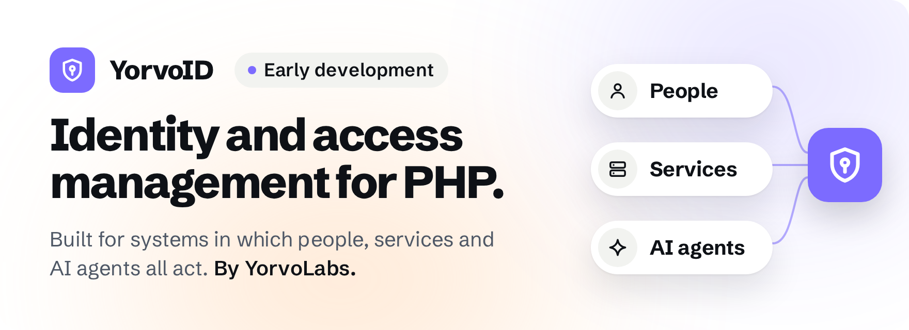

  

**Identity and access management for PHP, built for systems in which people, services and AI agents all act.** By [YorvoLabs](https://github.com/yorvolabs).

> [!NOTE]
> **Early development.** Nothing is released yet. Everything below is planned, not shipped, and the APIs will change.

YorvoID is a library your application embeds, not a server you run beside it. It is being built to answer who someone is, how they proved it, what they may do, under whose authority, and why, whether the one acting is a person, a service or an AI agent.

**Planned**

- Passkeys first, with sessions, step-up and recovery around them.
- Operations a passkey signed exactly, so an action can be traced to what was approved.
- Any PHP 8.5 application, with or without a framework; Symfony is the first integration.

**Where things are**

- **Code, issues and pull requests:** [yorvoid/yorvoid](https://github.com/yorvoid/yorvoid), the monorepo where all of YorvoID is developed.
- **Documentation:** [docs/](https://github.com/yorvoid/yorvoid/tree/main/docs), from the Symfony quickstart to the threat model.
- **Security:** report vulnerabilities privately, as [the security policy](https://github.com/yorvoid/yorvoid/security/policy) describes.
- **YorvoLabs:** [github.com/yorvolabs](https://github.com/yorvolabs).
<!-- When yorvolabs.com is live: point the YorvoLabs link above and in the byline to https://yorvolabs.com/products/yorvoid, and Documentation to https://yorvolabs.com/products/yorvoid/docs. -->

The other repositories here, such as `yorvoid/core` or `yorvoid/symfony`, are read-only copies of the monorepo's `packages/`, which Composer installs. Please open issues and pull requests in [yorvoid/yorvoid](https://github.com/yorvoid/yorvoid).

Licensed under the [Apache License 2.0](https://github.com/yorvoid/yorvoid/blob/main/LICENSE).
